# Práctica 3 - Visión por Computador
## [Marcial Galván](https://github.com/Jose-Marcial-GF) - [Alejandra Rodríguez](https://github.com/alejandra-rs)

Resolución de la tercera práctica de la asignatura Visión por Computador, en la que se busca aprender sobre:
- Detección de formas con distintos métodos, como la transformada de Hough y la detección de contornos.
- La segmentación y caracterización de objetos a partir de su forma y su apariencia.

### Tabla de contenidos
- [Tarea 1 - Contador de Monedas](#tarea-1-contador-de-monedas)
- [Tarea 2 - Clasificación de Microplásticos](#tarea-2-clasificación-de-microplásticos)
- [Fuentes consultadas](#fuentes-consultadas)

## Tarea 1: Contador de Monedas

En esta tarea se busca contar el dinero presente en una imagen, sin usar aprendizaje profundo.

Para justificar cada decisión del _pipeline_, se ha realizado un estudio de ablación en [`ablations_coins.ipynb`](ablations_coins.ipynb). Las pruebas realizadas son las siguientes:

- Filtro de ruido (bilateral, gaussiano, mediana o ninguno)
- Corrección gamma (0,4, 1 o 2)
- CLAHE
- Detector de bordes antes de Hough (Laplaciano, Canny o Sobel)
- Todas las combinaciones de los preprocesados anteriores
- Tipo de detección de círculos
- Parámetros de Hough (`param1` y `param2`)
- Filtro de radios grandes
- Eliminación de duplicados
- Tolerancia de tamaño en la clasificación
- Umbral de rojo adaptativo o fijo
- Zonas de la moneda para medir el color
- Uso de puntos característicos

El modelo final, en [`VC_P3.ipynb`](VC_P3.ipynb), contiene el siguiente _pipeline_:

- **Detección de círculos:** se suaviza la imagen con un filtro bilateral, se aplica una corrección gamma y se pasa a escala de grises ([`pre_hough_transforms`](VC_P3.ipynb)). Los círculos se detectan con `cv2.HOUGH_GRADIENT_ALT` ([`hough_circles_detection`](VC_P3.ipynb)) y se descartan los que son grandes ([`filter_big_radius`](VC_P3.ipynb)) y los duplicados ([`remove_duplicates`](VC_P3.ipynb)).
- **Clasificación por color** ([`color_probs`](VC_P3.ipynb)): se diferencian las monedas utilizando el mapa de color Lab. En primer lugar, se detecta si existe la presencua de un centro o anillo de color plateado (monedas de 1€ y 2€). A continuación, se hace la separación de las monedas restantes entre monedas de cobre y oro, se ajustado en cada imagen con umbralizado Otsu ([`red_threshold`](VC_P3.ipynb)).
- **Clasificación por tamaño:** se calcula la escala de la imagen automáticamente, eligiendo la que minimiza el error de los tamaños de todas las monedas ([`find_px_per_mm`](VC_P3.ipynb)). Cada moneda se clasifica combinando su metal y diámetro, descartándola si presenta un gran error ([`classify_coin`](VC_P3.ipynb)).
- **Demostrador en vivo:** se realiza todo el _pipeline_ por cada fotograma de la cámara, realizando un seguimiento de las monedas entre fotogramas ([`update_tracks`](VC_P3.ipynb)) para estabilizar la detección y la clasificación.

Resultados sobre las imágenes de prueba:

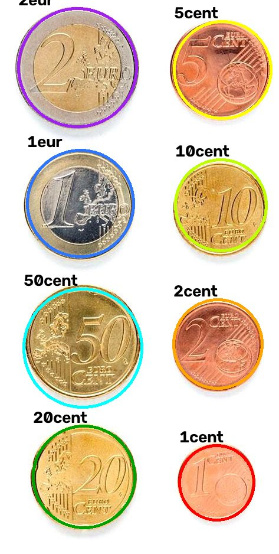
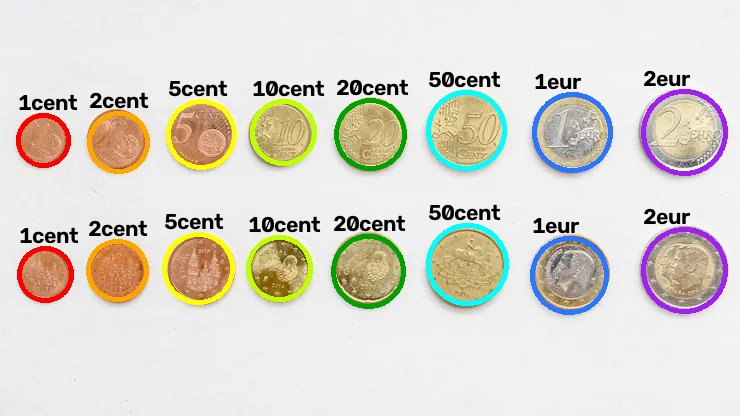

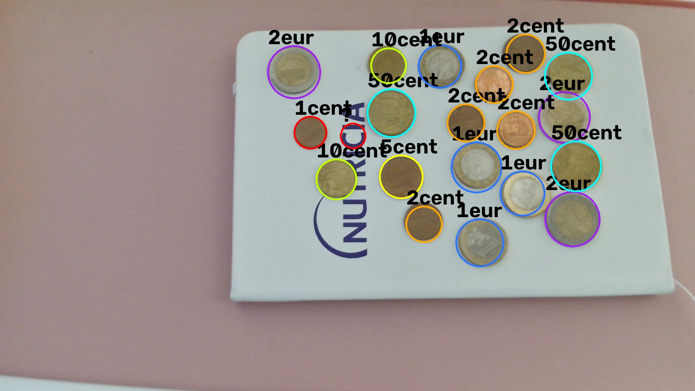

<i>Cada moneda se marca con su denominación. En rojo y con <code>?</code>, las descartadas.</i>

| Imagen | Círculos detectados | Monedas candidatas | Clasificadas | Descartadas | Total |
|---|---|---|---|---|---|
| `monedas1.jpg` | 22 | 20 | 19 | 1 | 11,86 € |
| `monedas2.jpg` | 8 | 8 | 8 | 0 | 3,88 € |
| `monedas3.webp` | 17 | 16 | 16 | 0 | 7,76 € |

En las tres imágenes se clasifican correctamente todas las monedas. En `monedas1.jpg`, una foto real, inclinada y con menos nitidez, se clasifican 19 monedas sobre los 20 círculos detectados: el sobrante es un falso círculo sobre el logotipo de la libreta, que se descarta.

### Demostrador en vivo

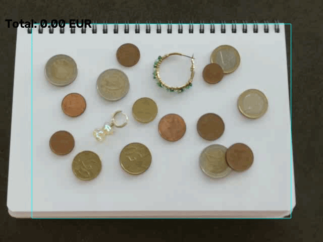

<i>Cada moneda se marca incluyendo el porcentaje de confianza en la detección. También se incluye el dinero total detectado.</i>

La grabación permite concluir que el _pipeline_ funciona con bastante exactitud. Permite detectar de forma rápida y estable las monedas que aparecen en la imagen. También permite detectar monedas superpuestas y descartar otros círculos que no sean monedas.

### Limitaciones

- **Iluminación:** la clasificación depende del color, por lo que reflejos, sombras o luz de distintos tonos podría afectar al rendimiento de la detección.
- **Calibración:** la calibración de la escala al utilizar monedas de varios metales. Si todas son del mismo metal, la escala puede ser ambigua.
- **Perspectiva:** si la cámara no está perpendicular a las monedas, estas se ven como elipses, lo que podría afectar a la detección y clasificación de las monedas.

## Tarea 2: Clasificación de Microplásticos

En esta tarea se busca clasificar las partículas del siguiente escáner de microplásticos encontrados en una playa de las islas:

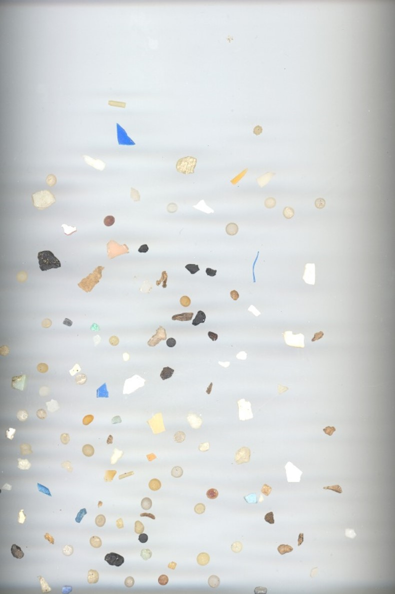

Para ello, se cuenta con un CSV en el que se definen las anotaciones de todas las _bounding box_ existentes en la imagen, cada una clasificada para su partícula correspondiente:

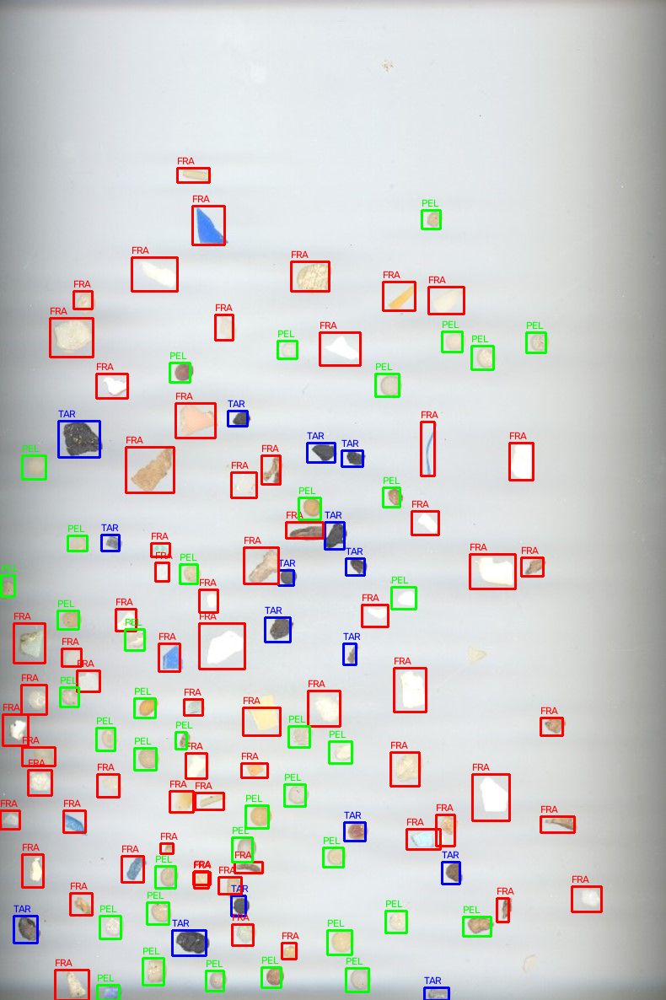

*Rojo: fragmentos (FRA). Verde: pellets (PEL). Azul: alquitrán (TAR).*

Para poder clasificar correctamente, se deben inferir las reglas que separan las partículas a partir de tres imágenes base, cada una con partículas de una sola clase:

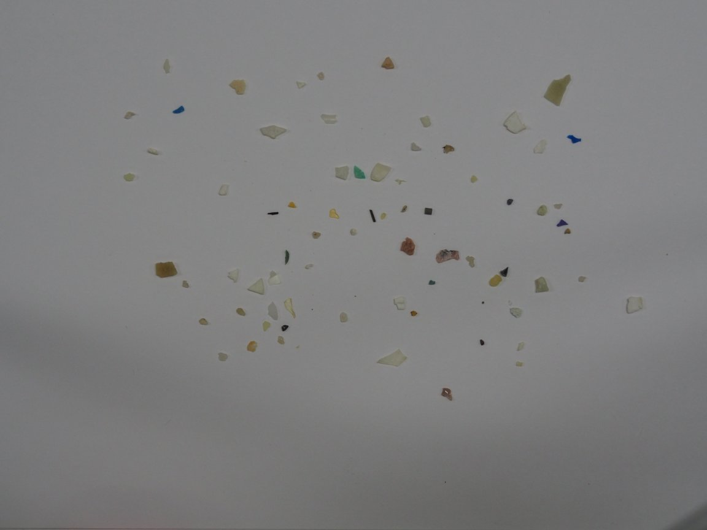
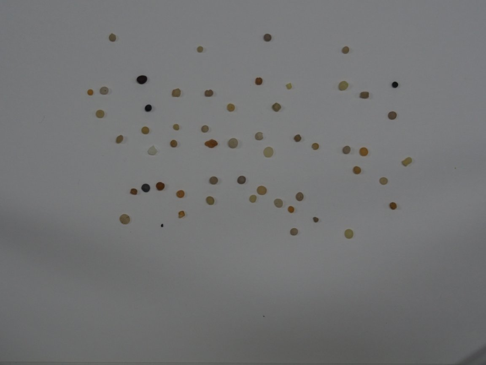
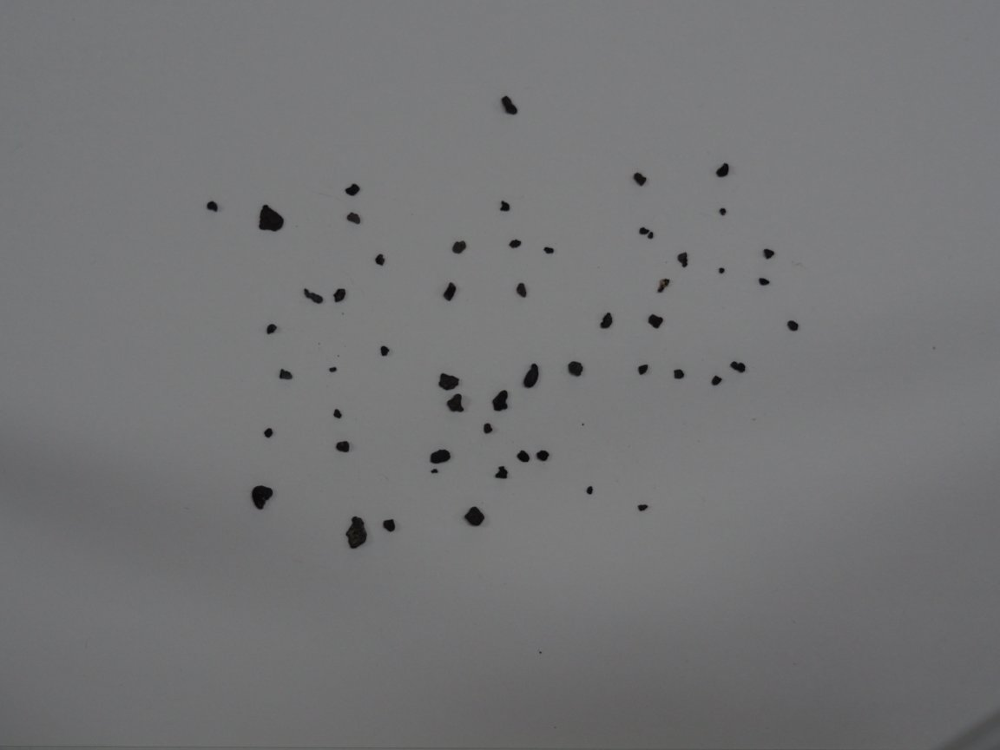

<i>Fragmentos, pellets y alquitrán.</i>

No se puede utilizar aprendizaje profundo para esta tarea, por lo que todas las soluciones incluirán algún tipo de heurística basada en geometría u otras características aparentes de las partículas. Para encontrar la mejor combinación de soluciones, se ha realizado un estudio de ablación, con distintos experimentos y su conclusión, en [`ablations_plastics.ipynb`](ablations_plastics.ipynb). Las pruebas realizadas en este estudio son las siguientes:

- Espacio de color (Lab o RGB)
- Filtro de suavizado (bilateral, gaussiano o ninguno)
- Valor del umbral de separación (6, 10, 14 y 18)
- Umbral adaptativo
- Margen en los bordes
- Fondo con suavizado mediano o gaussiano
- Reescalado de las fotos de entrenamiento
- Características geométricas de SMACC
- Luminosidad y/o color de TAR
- Textura (varianza del brillo y LBP)
- `cv2.matchShapes` para identificar contornos de formas similares
- _Data augmentation_
- Orden de las reglas en el clasificador

Finalmente, el modelo oficial, en [`VC_P3.ipynb`](VC_P3.ipynb), contiene el siguiente _pipeline_:

- **Preparación:** las fotos de entrenamiento se reducen al 25 % de su tamaño ([`load_training_image`](VC_P3.ipynb)) y se generan 5 versiones de cada una con _data augmentation_ ([`augment`](VC_P3.ipynb)). Se fija la semilla aleatoria (`np.random.seed(0)`) para que los resultados sean reproducibles.
- **Segmentación** ([`segment`](VC_P3.ipynb)): se suaviza la imagen con un filtro bilateral y se pasa a Lab. Se estima el fondo con un suavizado mediano de 101×101 ([`compute_background`](VC_P3.ipynb)). Se identifica como partícula cada contorno con un área válida, no cercana al borde ([`is_valid_particle`](VC_P3.ipynb)), cuya distancia de color al fondo supera el umbral de 10 ([`color_distance`](VC_P3.ipynb)).
- **Características** ([`extract_particles`](VC_P3.ipynb)): se calcula la circularidad de cada partícula ([`shape_features`](VC_P3.ipynb)), y su brillo y su color relativos al fondo ([`color_features`](VC_P3.ipynb)).
- **Clasificación por reglas** ([`predict`](VC_P3.ipynb)): heurísticas propias de acuerdo con la tarea encomendada. TAR si es oscuro y sin tonalidad, PEL si es redondo y FRA en otro caso. Los umbrales se eligen con una búsqueda en rejilla que maximiza el acierto equilibrado en las fotos de entrenamiento ([`fit`](VC_P3.ipynb)).
- **Evaluación:** en la imagen de _test_ cada partícula anotada se empareja con la detección con la que más se solapa, si su IoU es de al menos 0,3 ([`match`](VC_P3.ipynb)). A partir de esas parejas, se calculan las métricas y la matriz de confusión ([`evaluate`](VC_P3.ipynb)).

Con este _pipeline_, se logran unos resultados correctos:

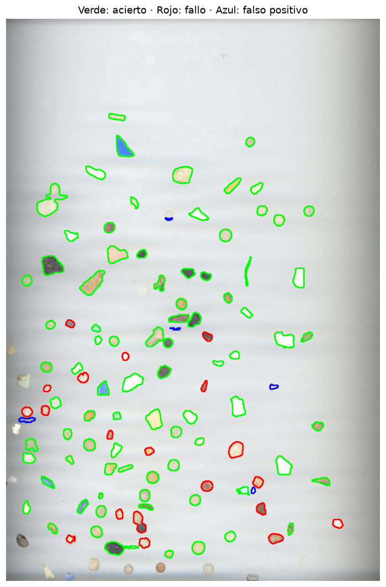
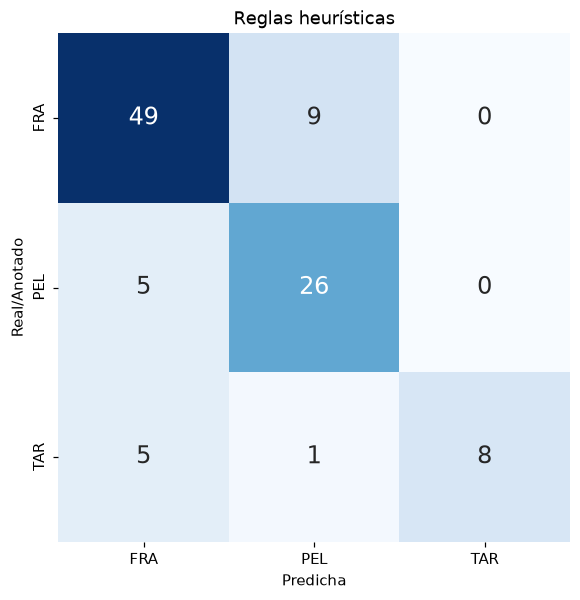

<i>Verde: bien clasificada - Rojo: mal clasificada - Azul: falso positivo.</i>

| Anotadas | Detectadas | Emparejadas | No detectadas | Falsos positivos | Correctas |
|---|---|---|---|---|---|
| 120 | 108 | 103 | 17 | 5 | **83** |

| Accuracy | Precision | Recall | F1 | Balanced accuracy |
|---|---|---|---|---|
| 0,806 | 0,821 | 0,806 | 0,804 | 0,752 |

| Clase | Precision | Recall | F1 | Partículas |
|---|---|---|---|---|
| FRA | 0,83 | 0,84 | 0,84 | 58 |
| PEL | 0,72 | 0,84 | 0,78 | 31 |
| TAR | 1,00 | 0,57 | 0,73 | 14 |

Los errores más frecuentes son la confusión entre fragmentos y pellets (fragmentos redondeados y pellets deformados) y el alquitrán clasificado como fragmento. Ninguna partícula se clasifica como alquitrán sin serlo (precisión de 1,00).

### Comparación con otros clasificadores

Como comprobación adicional, se han entrenado clasificadores clásicos con las mismas características e imágenes de entrenamiento, para comparar su eficacia en las imágenes de _test_:

| Modelo | Balanced accuracy (entrenamiento) | Accuracy | Balanced accuracy | F1 | Correctas / 120 |
|---|---|---|---|---|---|
| **Reglas heurísticas** | 0,838 | **0,806** | **0,752** | **0,804** | **83** |
| k-NN (k = 5) | 0,917 | 0,660 | 0,550 | 0,584 | 68 |
| Árbol de decisión (profundidad 3) | 0,885 | 0,641 | 0,498 | 0,549 | 66 |
| SVM (RBF) | 0,902 | 0,650 | 0,522 | 0,565 | 67 |
| Random Forest | **1,000** | 0,641 | 0,498 | 0,549 | 66 |

Las reglas obtienen el mejor resultado en la imagen de _test_, aunque son las que peor puntúan en el entrenamiento: los clasificadores entrenados llegan a 0,88–1,00 en entrenamiento, pero bajan a 0,50–0,55 en el _test_. La causa podría ser el cambio de dispositivo: en el escáner, todas las partículas se ven más claras y con más color que en las fotos de cámara. Los clasificadores entrenados aprenden reglas más complejas que podrían dejar de cumplirse al cambiar de dispositivo. Las reglas, en cambio, al ser más sencillas, solo usan lo más "evidente" y que, por tanto, se mantiene en cámara y en escáner.

### Limitaciones

- **Cambio de dispositivo:** las imágenes de entrenamiento son fotos de cámara y la de _test_ es un escáner, con otra resolución, iluminación y tonalidad. No hay variedad de imágenes en el entrenamiento, por lo que las heurísticas son más frágiles.
- **Partículas claras:** los fragmentos blancos o translúcidos son casi del mismo tono que el papel, y algunos no se detectan (17 partículas no detectadas en _test_).
- **Dependencia de la semilla:** el _data augmentation_ es aleatorio, por lo que con otra semilla los umbrales y los resultados podrían cambiar ligeramente.

## Fuentes consultadas

### Tarea 1: Contador de Monedas

- [Hough Circle Transform (`cv2.HoughCircles`) - OpenCV](https://docs.opencv.org/4.13.0/dd/d1a/group__imgproc__feature.html#ga47849c3be0d0406ad3ca45db65a25d2d)
- [HoughModes (`cv2.HOUGH_GRADIENT_ALT`) - OpenCV](https://docs.opencv.org/4.13.0/dd/d1a/group__imgproc__feature.html#gga073687a5b96ac7a3ab5802eb5510fe65aad57c72131c801de427f1fdb55c8c8ad)
- [Hough Transform | Boundary Detection - YouTube](https://www.youtube.com/watch?v=XRBc_xkZREg)
- [cv2.Laplacian - TheAILearner](https://theailearner.com/tag/cv2-laplacian/)
- [Histogram Equalization (CLAHE) - OpenCV](https://docs.opencv.org/4.13.0/d5/daf/tutorial_py_histogram_equalization.html)
- [How to apply CLAHE on RGB color images - Stack Overflow](https://stackoverflow.com/questions/25008458/how-to-apply-clahe-on-rgb-color-images)
- [Apply Gamma Correction to an Image using OpenCV - Lindevs](https://lindevs.com/apply-gamma-correction-to-an-image-using-opencv/)
- [Color Detection using Python and OpenCV - Medium](https://agneya.medium.com/color-detection-using-python-and-opencv-8305c29d4a42)
- [cv::SIFT Class Reference - OpenCV](https://docs.opencv.org/4.13.0/d7/d60/classcv_1_1SIFT.html)
- [Comprehensive empirical evaluation of feature extractors in computer vision - PeerJ Computer Science](https://peerj.com/articles/cs-2415/)

### Tarea 2: Clasificación de Microplásticos

- [Contours Hierarchy - OpenCV](https://docs.opencv.org/4.13.0/d9/d8b/tutorial_py_contours_hierarchy.html)
- [Contour Detection using OpenCV (Python/C++) - LearnOpenCV](https://learnopencv.com/contour-detection-using-opencv-python-c/#runtime-comparison)
- [Compactness measure - Wikipedia](https://en.wikipedia.org/wiki/Compactness_measure)
- [Convex hull - Wikipedia](https://en.wikipedia.org/wiki/Convex_hull)
- [Artículo 8976153 - IEEE Xplore](https://ieeexplore.ieee.org/document/8976153)
- [How to use OpenCV for matching shapes and contours - CodingTechRoom](https://codingtechroom.com/question/how-to-use-opencv-matching-shapes-contours)
- [How to match image shapes in OpenCV Python - Tutorialspoint](http://tutorialspoint.com/article/how-to-match-image-shapes-in-opencv-python)

### Tareas 1 y 2

- [Thresholding in OpenCV - PythonGeeks](https://pythongeeks.org/thresholding-in-opencv/)
- [Bilateral Filter (`cv2.bilateralFilter`) - OpenCV](https://docs.opencv.org/4.13.0/d4/d86/group__imgproc__filter.html#ga9d7064d478c95d60003cf839430737ed)
- [Color Spaces in OpenCV (Lab) - OpenCV](https://opencv.org/color-spaces-in-opencv/#h-lab-lightness-a-channel-b-channel-color-space)
- [Drawing Functions in OpenCV - OpenCV](https://docs.opencv.org/4.13.0/dc/da5/tutorial_py_drawing_functions.html)
- [pandas.DataFrame - pandas](https://pandas.pydata.org/pandas-docs/stable/reference/api/pandas.DataFrame.html)

_Se usó Claude (Anthropic) como asistente para: discutir enfoques de segmentación y clasificación, explicar conceptos (espacio Lab, IoU, aumento de datos, *balanced accuracy*), revisar y simplificar el código, detectar errores (p. ej., ancho y alto intercambiados en el filtro de bordes) y ejecutar los experimentos de ablación recogidos en [`ablations_plastics.ipynb`](ablations_plastics.ipynb). Las decisiones de diseño se discutieron y validaron con experimentos antes de incorporarlas._