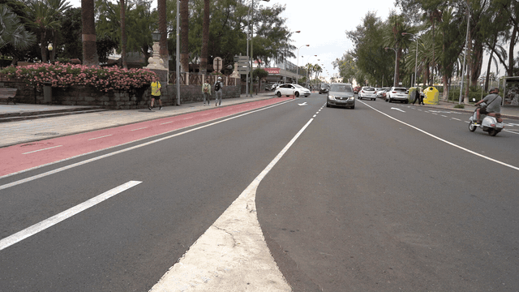
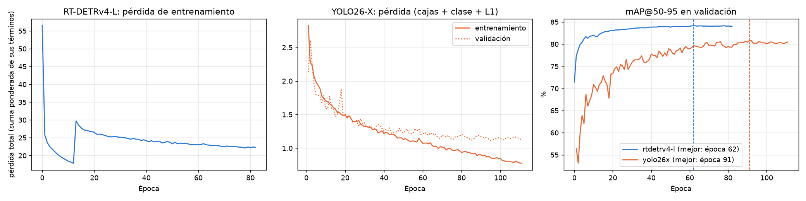
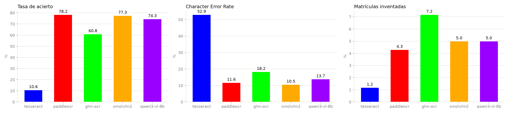
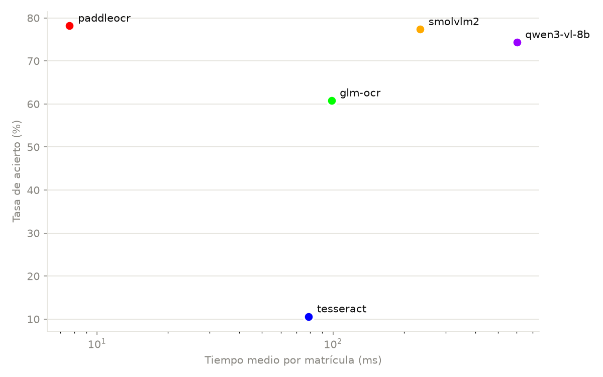
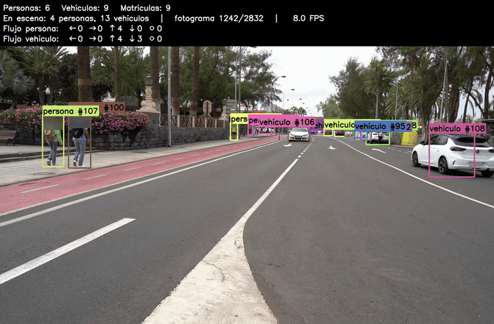

# Práctica 4 - Visión por Computador
## [Marcial Galván](https://github.com/Jose-Marcial-GF) - [Alejandra Rodríguez](https://github.com/alejandra-rs)

> [!NOTE]
> Sobre el _environment_ de prácticas anteriores, esta práctica necesita una GPU NVIDIA y librerías adicionales (PyTorch con CUDA, Ultralytics, PaddleOCR...). Los pasos están en [Instalación y uso](#instalación-y-uso).

Resolución de la cuarta práctica de la asignatura Visión por Computador, en la que se busca aprender sobre:
- Detección de objetos y seguimiento (_tracking_) con aprendizaje profundo, comparando distintas familias de detectores.
- Entrenamiento y evaluación de un detector propio (matrículas), con YOLO y con RT-DETR, y con técnicas clásicas basadas en contornos.
- Reconocimiento de texto (OCR) con un sistema clásico y con modelos de lenguaje con visión (VLM).

El programa final es [`prac4.ipynb`](prac4.ipynb): procesa un vídeo, detecta y sigue a las personas y los vehículos, detecta y lee sus matrículas, cuenta los objetos y su flujo, y guarda un vídeo anonimizado y otro con la lectura de las matrículas, cada uno con su CSV. El resto de cuadernos justifican, con datos, cada uno de los modelos que utiliza.

<p align=center>
<a href="./results/video/C0142_original.mp4"></a>
</p>

<p align=center><i>Vídeo de entrada (al pulsar sobre el GIF se abre el vídeo completo, comprimido).</i></p>

### Tabla de contenidos
- [Tarea 1 - Detección y seguimiento de personas y vehículos](#tarea-1-detección-y-seguimiento-de-personas-y-vehículos)
- [Tarea 2 - Detección de matrículas](#tarea-2-detección-de-matrículas)
- [Tarea 3 - Lectura de matrículas](#tarea-3-lectura-de-matrículas)
- [Resultados](#resultados)
- [Instalación y uso](#instalación-y-uso)
    - [Instalación](#instalación)
    - [Datos y pesos](#datos-y-pesos)
    - [Uso](#uso)
    - [TensorBoard](#tensorboard)
- [Especificaciones del equipo](#especificaciones-del-equipo)
- [Fuentes consultadas](#fuentes-consultadas)

## Tarea 1: Detección y seguimiento de personas y vehículos

En esta primera tarea se busca detectar y seguir a las personas y los vehículos de un vídeo. Para elegir el detector, se ha realizado una comparativa en [`det_module1_comparative.ipynb`](det_module1_comparative.ipynb), con las versiones S y L de cuatro familias (RT-DETRv4, YOLO26, DEIMv2 y ECDet) y la versión X de YOLO26, en las mismas condiciones:

- **Datos:** las 5,000 imágenes de validación de COCO.
- **Clases:** solo personas (`person`) y vehículos (`car`, `motorcycle`, `bus` y `truck`), además de las métricas del conjunto de los vehículos.
- **Métricas:** mAP@50-95 y mAP@50, además de _precision_, _recall_ y _accuracy_ con confianza ≥ 0.5 e IoU ≥ 0.5.
- **Tiempo:** inferencia completa por imagen (preprocesado, modelo y postprocesado), con _batch_ 1 y sin contar la lectura de disco.

Los resultados obtenidos se recogen en esta tabla:

| Modelo | Parámetros (M) | ms por imagen | Imágenes/s | mAP@50-95 | Precision | Recall |
|---|---|---|---|---|---|---|
| ECDet-L | 32.7 | 16.7 | 60 | 0.612 | 0.847 | 0.723 |
| DEIMv2-L | 32.2 | 18.1 | 55 | 0.606 | 0.847 | 0.712 |
| **RT-DETRv4-L** | **31.0** | **18.3** | **55** | **0.603** | **0.847** | **0.725** |
| YOLO26-X | 59.0 | 12.6 | 79 | 0.603 | 0.908 | 0.660 |
| YOLO26-L | 26.3 | 11.1 | 90 | 0.588 | 0.911 | 0.633 |
| ECDet-S | 9.8 | 12.5 | 80 | 0.569 | 0.854 | 0.687 |
| DEIMv2-S | 9.7 | 13.5 | 74 | 0.558 | 0.843 | 0.675 |
| RT-DETRv4-S | 10.4 | 10.7 | 94 | 0.551 | 0.846 | 0.670 |
| YOLO26-S | 10.0 | 7.3 | 137 | 0.531 | 0.917 | 0.581 |

Se elige **RT-DETRv4-L** porque es el detector que proporciona mejores métricas, especialmente en cuanto a exhaustividad, pues es extremadamente importante que se detecten todos los vehículos que se puedan. Cada vehículo no detectado es un vehículo sin matrícula leída y sin contar.

### Elección de _tracker_

Se utiliza **ByteTrack** de Ultralytics ([`new_tracker`](prac4.ipynb) y [`update_tracker`](prac4.ipynb)). Este _tracker_ genera el seguimiento utilizando únicamente la posición y movimiento del objeto (filtro de Kalman e IoU), en dos pasadas: primero con las detecciones de confianza alta y después con las de confianza baja (objetos parcialmente tapados).

Se ha elegido frente a otros _trackers_ por las características del problema:
- La cámara es fija y los vehículos no cambian bruscamente de dirección ni de velocidad, por lo que no hacen falta modelos más potentes como OC-SORT, diseñados para movimientos bruscos o cámaras móviles.
- No hay oclusiones largas de vehículos ni de personas, por lo que no hace falta reidentificar objetos (BoT-SORT-ReID). Además, esto aumentaría el tiempo de cómputo.
- Puede haber varios objetos en escena a la vez, y en esos casos, en los _benchmarks_ de seguimiento (MOT), ByteTrack obtiene mejores resultados que OC-SORT.

Se ha cambiado un único parámetro de su configuración: el valor de `new_track_thresh`, a 0.25 por defecto y modificado a 0.5. De no realizar este cambio, los objetos pequeños o lejanos que aparecen y desaparecen reciben un identificador nuevo cada vez. Ahora, se intenta solo crear identificadores nuevos para detecciones claras.

## Tarea 2: Detección de matrículas

En esta tarea se busca detectar la matrícula de cada vehículo. Se entrenan y se comparan dos detectores de redes neuronales (YOLO26-X y RT-DETRv4-L) y un detector clásico basado en contornos.

### Conjunto de datos

La matrícula ocupa muy pocos píxeles en el fotograma completo (al reducirlo a la resolución de entrada prácticamente desaparece), por lo que el detector trabaja sobre el **recorte de cada vehículo**. [`build_vehicle_dataset.ipynb`](plates_module2/build_vehicle_dataset.ipynb) detecta los vehículos de las fotos del conjunto de la asignatura con RT-DETRv4-L, los recorta y asigna a cada recorte las matrículas anotadas en él. El reparto en entrenamiento, validación y _test_ es 70 / 15 / 15 por fotografía (semilla 0). De esta forma, todos los recortes de una misma fotografía se encuentran en el mismo conjunto, para evitar sesgos por repeticiones entre ellos:

| Conjunto | Recortes de vehículo | Matrículas |
|---|---|---|
| train | 6,083 | 4,258 |
| val | 1,358 | 931 |
| test | 1,256 | 894 |

### Entrenamiento

Los dos modelos parten de los pesos de COCO y se entrenan en [`train_plate_detectors.ipynb`](plates_module2/train_plate_detectors.ipynb) en las mismas condiciones:

- **Datos:** `train` para entrenar y `val` para evaluar el modelo al final de cada época.
- **Épocas:** hasta 200, con _early stopping_: el entrenamiento se para si el mAP@50-95 de validación no mejora en 20 épocas seguidas, y se guarda el modelo de la mejor época y el de la última.
- **Tamaño de _batch_:** 12 imágenes, con la semilla fijada.
- **_Data augmentation_:** el proporcionado por cada modelo (mosaico, _flips_, cambios de color, de escala...).

<p align=center>

</p>

<p align=center><i>Pérdida de entrenamiento de cada modelo y mAP@50-95 de validación. La línea discontinua marca la mejor época.</i></p>

RT-DETRv4 alcanza mejores resultados que YOLO y en un menor número de épocas:
- **RT-DETRv4-L** alcanzó su mejor mAP@50-95 de validación (0.842) en la época 62 y paró en la 82. El salto de la pérdida en la época 13 se debe a la configuración de su _pipeline_. En esa época, se activa _data augmentation_, formando una segunda etapa del entrenamiento.
- **YOLO26-X** alcanzó su mejor mAP@50-95 (0.808) en la época 91 y paró en la 111. Su pérdida de validación se estanca hacia la época 60 mientras la de entrenamiento sigue bajando, lo que probablemente indique un _overfitting_. Aun así, el mAP sigue mejorando ligeramente hasta la época 91.

Las métricas de cada época se encuentran en `runs/plates/*/results.csv`, y los registros completos en [TensorBoard](#tensorboard).

### Detector por contornos

[`contours.ipynb`](plates_module2/contours.ipynb) implementa un detector clásico, sin redes neuronales, con el siguiente _pipeline_:

- **Candidatos:** se preprocesa el recorte y se buscan candidatos por tres vías: bordes, zonas blancas y líneas de Hough. Para cada candidato, se obtiene el rectángulo más pequeño que la contiene.
- **Filtrado:** se descartan los candidatos con una forma o un tamaño que no corresponde a una matrícula, eliminando también los duplicados.
- **Puntuación:** se puntúa cada candidato según 5 criterios (proporción de blanco, perfiles vertical y horizontal, mitad inferior y anchura). Se elige el candidato con mayor puntuación.

### Comparativa

En [`plates_module2_comparative.ipynb`](plates_module2_comparative.ipynb) se realiza la evaluación de todos los detectores. Se incluyen los recortes sin matrícula, en los que cualquier detección es un falso positivo. Las métricas y el tiempo se miden igual que en la tarea 1, incluyendo el tiempo por recorte.

| Detector | Parámetros (M) | ms por recorte | mAP@50-95 | mAP@50 | Precision | Recall |
|---|---|---|---|---|---|---|
| YOLO26-X (mejor época) | 58.8 | 19.2 | 0.789 | 0.941 | 0.902 | 0.919 |
| YOLO26-X (última época) | 58.8 | 16.8 | 0.789 | 0.942 | 0.905 | 0.922 |
| **RT-DETRv4-L (mejor época)** | **30.9** | **19.8** | **0.836** | **0.969** | **0.901** | **0.949** |
| RT-DETRv4-L (última época) | 30.9 | 19.4 | 0.836 | 0.968 | 0.914 | 0.943 |
| Contornos (sin red neuronal) | 0.0 | 28.2 | 0.059 | 0.112 | 0.210 | 0.281 |

**RT-DETRv4-L** es el detector de matrículas escogido. Supera a YOLO26-X en métricas, con la mitad de parámetros y un tiempo de procesamiento similar. El detector por contornos queda muy por debajo (mAP@50-95 de 0.059), aunque funciona sin necesidad de realizar entrenamientos.

## Tarea 3: Lectura de matrículas

En esta tarea se busca leer el texto de las matrículas detectadas. En [`ocr_module3_comparative.ipynb`](ocr_module3_comparative.ipynb) se comparan 5 sistemas, probados en las mismas condiciones:

- **Tesseract**, OCR clásico y antiguo.
- **PaddleOCR**, OCR clásico moderno, con su modelo de reconocimiento de texto `PP-OCRv5_server_rec`.
- **GLM-OCR, SmolVLM2 y Qwen3-VL 8B**, modelos de visión y lenguaje (VLM).

Las métricas son:
- **Acierto:** porcentaje de matrículas leídas correctamente.
- **CER** (_character error rate_): errores cometidos a nivel de carácter.
- **Formato válido:** lecturas con formato válido para una matrícula española.
- **Inventadas:** porcentaje de matrículas ilegibles que se leen como una matrícula válida.
- **Tiempo y memoria:** tiempo medio por matrícula y memoria máxima de la GPU.

| Modelo | Acierto | CER | Formato válido | Inventadas | ms por matrícula | VRAM (MB) |
|---|---|---|---|---|---|---|
| Tesseract | 10.6 % | 52.9 % | 13.4 % | 1.2 % | 78.9 | 232 |
| **PaddleOCR** | **78.2 %** | **11.6 %** | **81.7 %** | **4.3 %** | **7.7** | **471** |
| GLM-OCR (VLM) | 60.8 % | 18.2 % | 65.6 % | 7.2 % | 98.4 | 3,674 |
| SmolVLM2 (VLM) | 77.3 % | 10.5 % | 86.0 % | 5.0 % | 234.0 | 5,316 |
| Qwen3-VL 8B (VLM) | 74.3 % | 13.7 % | 82.2 % | 5.0 % | 601.3 | 10,722 |

<p align=center>

</p>

<p align=center>

</p>

<p align=center><i>Acierto, CER y matrículas inventadas de cada sistema, y acierto frente al tiempo medio por matrícula.</i></p>

**PaddleOCR** ofrece el mejor equilibrio, y es por ello el OCR elegido para el modelo final ([`PaddleOCRModel`](common/ocr.py)):

- **Acierto:** PaddleOCR (78.2 %) y SmolVLM2 (77.3 %) son los que más matrículas leen correctamente. Tesseract apenas acierta (10.6 %), probablemente al estar pensado para texto de documentos.
- **Tiempo y memoria:** PaddleOCR lee una matrícula en 7.7 ms y usa 471 MB de GPU; SmolVLM2 tarda unas 31 veces más y Qwen3-VL unas 79 veces más, sin acertar más. Solo PaddleOCR (unas 130 matrículas/seg) es viable para tiempo real.
- **Tamaño:** Aun siendo de los modelos más reducidos en tamaño, PaddleOCR ofrece métricas mejores o similares que el resto de modelos.
- **Matrículas inventadas:** entre el 4 % y el 7 % en todos los modelos salvo Tesseract, que casi nunca lee nada con formato válido. Por eso no conviene fiarse de una sola lectura, razón por la cual en el programa final se usan técnicas adicionales como repetición de lecturas.

## Resultados

El modelo final, en [`prac4.ipynb`](prac4.ipynb), contiene el siguiente _pipeline_ para cada fotograma del vídeo:

1. **Detección y seguimiento de personas y vehículos:** RT-DETRv4-L con los pesos de COCO ([`ObjectDetector`](common/detectors.py)) y ByteTrack ([`update_tracker`](prac4.ipynb)).
2.  **Detección de matrículas** ([`find_plates`](prac4.ipynb)): se recorta cada vehículo y se pasan al RT-DETRv4-L entrenado ([`PlateDetector`](prac4.ipynb)). Las cajas se pasan a coordenadas del fotograma completo y se asocian al identificador de su vehículo.
3. **Lectura de matrículas** ([`PlateReader`](prac4.ipynb)): PaddleOCR lee el recorte de la matrícula. Se descartan las lecturas de menos de 4 caracteres. Se asocia al vehículo la matrícula más leída por el OCR. En caso de repetir 10 lecturas iguales seguidas, se da por válida y se asocia permanentemente al vehículo.
4. **Recuento y flujo** ([`FlowCounter`](prac4.ipynb)): se cuenta el flujo de vehículos vertical (alejándose o acercándose de la cámara, con su cambio de escala) y horizontal (izquierda o derecha, con su desplazamiento horizontal).
5. **Anonimización** ([`anonymize`](prac4.ipynb)): se desenfoca el 30 % superior de la caja de cada persona y la caja de cada matrícula. Con este desenfoque, PaddleOCR no es capaz de leer las matrículas.
6. **Vídeo y CSV** ([`process_video`](prac4.ipynb)): se guarda el vídeo analizado, y el CSV con una fila por cada objeto seguido en cada fotograma.

Al pulsar sobre cada GIF se abre el vídeo completo. Debajo de cada uno están su CSV y su resumen.

| Vídeo anonimizado | Vídeo con OCR |
|:-:|:-:|
| [](./results/video/readme/C0142_anonimizado.mp4) | [](./results/video/readme/C0142_ocr.mp4) |
| [CSV](./results/video/C0142_anonimizado.csv) - [resumen](./results/video/C0142_anonimizado.json) | [CSV](./results/video/C0142_ocr.csv) - [resumen](./results/video/C0142_ocr.json) |

El CSV tiene las siguientes columnas: `fotograma, tipo_objeto, confianza, identificador_tracking, x1, y1, x2, y2, matricula_en_su_caso, confianza_matricula, mx1, my1, mx2, my2, texto_matricula`.

### Resultados

Resumen de `C0142.MP4` (2,832 fotogramas): se cuentan 20 personas y 32 vehículos distintos, y se detecta la matrícula de 31 de ellos. El flujo de cada grupo es:

|  | Izquierda | Derecha | Se aleja | Se acerca | Parados |
|---|---|---|---|---|---|
| Personas | 1 | 0 | 14 | 3 | 2 |
| Vehículos | 0 | 0 | 15 | 17 | 0 |

El programa procesa 9.6 fotogramas por segundo de media, por lo que no funciona en tiempo real, aunque tiene un tiempo de procesado asumible.

## Instalación y uso

### Instalación

Se ha probado con Python 3.11 y una GPU NVIDIA con CUDA 13 (Windows 11, RTX 5080).

1. Crear un entorno virtual con Python 3.11 y activarlo.
2. Instalar PyTorch con CUDA antes que el resto. Una RTX 5080 (Blackwell) necesita CUDA 12.8 o superior:
   ```
   pip install torch torchvision --index-url https://download.pytorch.org/whl/cu130
   ```
3. Instalar el resto de dependencias ([`requirements.txt`](requirements.txt)):
   ```
   pip install -r requirements.txt
   ```
4. Instalar PaddlePaddle con GPU, que no está en PyPI (el comando es de `uv`; con `pip` no existe `--index-strategy`):
   ```
   uv pip install paddlepaddle-gpu==3.4.0 --index-url https://www.paddlepaddle.org.cn/packages/stable/cu130/ --extra-index-url https://pypi.org/simple --index-strategy unsafe-best-match
   ```
5. Igualar la versión de cuDNN de PaddlePaddle con la de PyTorch, que no pueden convivir con versiones distintas:
   ```
   pip install nvidia-cudnn-cu13==9.24.0.43
   ```
6. Dejar un solo OpenCV. Si Ultralytics instala `opencv-python` a la vez que `opencv-contrib-python`, se rompe `cv2`:
   ```
   pip uninstall opencv-python opencv-contrib-python
   pip install opencv-contrib-python==4.10.0.84
   ```

En el código, `torch` se importa siempre antes que `paddleocr`: en el orden contrario falla la carga de las librerías de la GPU.

Además, para ejecutar la comparativa de OCR ([`ocr_module3_comparative.ipynb`](ocr_module3_comparative.ipynb)):
- Instalar el programa **Tesseract** y añadirlo al `PATH`.
- Instalar **Ollama** y descargar los modelos: `ollama pull glm-ocr:bf16` y `ollama pull qwen3-vl:8b-instruct-q8_0`. SmolVLM2 se descarga automáticamente desde Hugging Face.

### Datos y pesos

Los repositorios de los modelos (RT-DETRv4, DEIMv2 y EdgeCrafter) y sus pesos de COCO se descargan automáticamente la primera vez que se necesitan. Además de estos, se necesitarán:

- **Imágenes de COCO** (`coco/`): la comparativa de detectores las descarga sola (`val2017`, 5,000 imágenes).
- **Conjunto de matrículas de la asignatura**: se puede descargar [Google Drive](https://drive.google.com/drive/folders/1RFd6sKH_QMQcpE_w5rWmy8rKiYUY5_SI?usp=drive_link), y debe estar en una carpeta `dataset/` (con `images/` y `annotations/`) junto a la carpeta `prac4/`.
- **Vídeo de entrada** (`C0142.MP4`): en la raíz de `prac4/`. Se puede usar el [vídeo comprimido](results/video/C0142_original.mp4) cambiando `VIDEO` en el cuaderno.

El resto de recursos (como la carpeta de recortes de vehículos) se genera automáticamente, si es necesario, al ejecutar los distintos cuadernos.

### Uso

Los cuadernos se pueden ejecutar de forma independiente en este orden, y cada uno reutiliza los resultados que ya haya guardado (a no ser que se indique `FORCE = True`):

1. [`det_module1_comparative.ipynb`](det_module1_comparative.ipynb): descarga COCO y mide los 9 detectores.
2. [`plates_module2/build_vehicle_dataset.ipynb`](plates_module2/build_vehicle_dataset.ipynb): crea el conjunto de entrenamiento.
3. [`plates_module2/train_plate_detectors.ipynb`](plates_module2/train_plate_detectors.ipynb) y [`plates_module2/contours.ipynb`](plates_module2/contours.ipynb): implementa un detector de contornos y entrena YOLO26-X y RT-DETRv4-L para detectar matrículas.
4. [`plates_module2_comparative.ipynb`](plates_module2_comparative.ipynb): comparativa de los detectores de matrículas.
5. [`ocr_module3_comparative.ipynb`](ocr_module3_comparative.ipynb): comparativa de OCR.
6. [`prac4.ipynb`](prac4.ipynb): procesa el vídeo.

Todos los cuadernos conservan sus salidas, por lo que se pueden leer sin ejecutarlos. El código compartido está en [`common/`](common).

Para procesar otro vídeo basta con ejecutar `prac4.ipynb`, cambiando antes `VIDEO` si es otro. El procesado se puede configurar con 2 opciones:
- `SHOW`: si es `True`, el vídeo se muestra en una ventana mientras se procesa (**ESC** lo para).
- `FORCE`: si es `False` y el vídeo ya está procesado, se reutiliza el resultado guardado.

Por cada vídeo salen tres ficheros en [`results/video/`](results/video): el vídeo (`.mp4`), el CSV y un resumen (`.json`).

### TensorBoard

Los registros de todos los entrenamientos y comparativas están en el repositorio y se pueden consultar. Desde la carpeta `prac4/`:

```
tensorboard --logdir runs
tensorboard --logdir ocr/runs
```

y abrir <http://localhost:6006>.

## Especificaciones del equipo

Los tiempos de todas las comparativas se han medido en el mismo equipo:

| Componente | Detalle |
|---|---|
| Sistema operativo | Windows 11 |
| CPU | AMD, 8 núcleos físicos |
| RAM | 34 GB |
| GPU | NVIDIA GeForce RTX 5080 (16 GB), controlador 610.88 |
| CUDA | 13.0 |
| Python | 3.11.18 |
| Librerías | torch 2.14.1+cu130, ultralytics 8.4, paddlepaddle-gpu 3.4.0, paddleocr 3.7.0, OpenCV 4.10.0.84 |
| OCR | Tesseract 5.5.3, Ollama 0.30.10 |

## Fuentes consultadas

### Tarea 1: Detección y seguimiento de personas y vehículos

- [RT-DETRv4 - GitHub](https://github.com/RT-DETRs/RT-DETRv4)
- [DEIMv2 - GitHub](https://github.com/Intellindust-AI-Lab/DEIMv2)
- [EdgeCrafter (ECDet) - GitHub](https://github.com/Intellindust-AI-Lab/EdgeCrafter)
- [Ultralytics Docs (YOLO26 y ByteTrack)](https://docs.ultralytics.com)
- [Gráfica de comparación de modelos de detección - Vision Analysis](https://www.visionanalysis.org/?families=ec%2Cyolo26%2Crtdetrv4%2Cdeimv2)
- [Comparativa de _trackers_ (DeepSORT, ByteTrack y OC-SORT) - Fora Soft](https://www.forasoft.com/learn/ai-for-video-engineering/articles-ai/multi-object-tracking-deepsort-bytetrack-ocsort)
- [COCO - Common Objects in Context](https://cocodataset.org/#home)
- [DETRs Beat YOLOs on Real-time Object Detection (RT-DETR) - arXiv](https://arxiv.org/abs/2304.08069)
- [ByteTrack: Multi-Object Tracking by Associating Every Detection Box - arXiv](https://arxiv.org/abs/2110.06864)

### Tarea 2: Detección de matrículas

- [Formato de datos de detección (YOLO) - Ultralytics Docs](https://docs.ultralytics.com/datasets/detect)
- [COCO - Common Objects in Context](https://cocodataset.org/#home)
- [YOLO26 - Ultralytics Docs](https://docs.ultralytics.com/models/yolo26/)
- [Modo de entrenamiento - Ultralytics Docs](https://docs.ultralytics.com/modes/train/)
- [faster-coco-eval (métricas de COCO, como el mAP) - GitHub](https://github.com/MiXaiLL76/faster_coco_eval)
- [TensorBoard - TensorFlow](https://www.tensorflow.org/tensorboard)
- [Structural Analysis and Shape Descriptors (`cv2.findContours`, `cv2.minAreaRect`) - OpenCV](https://docs.opencv.org/4.x/d3/dc0/group__imgproc__shape.html)

### Tarea 3: Lectura de matrículas

- [PaddleOCR - GitHub](https://github.com/PaddlePaddle/PaddleOCR)
- [Tesseract OCR - GitHub](https://github.com/tesseract-ocr/tesseract)
- [Ollama](https://ollama.com)
- [SmolVLM2-2.2B-Instruct - Hugging Face](https://huggingface.co/HuggingFaceTB/SmolVLM2-2.2B-Instruct)
- [PP-OCRv5 (modelo de PaddleOCR) - PaddleOCR Docs](https://paddlepaddle.github.io/PaddleOCR/latest/en/version3.x/algorithm/PP-OCRv5/PP-OCRv5.html)
- [Documentación de Tesseract - tessdoc](https://tesseract-ocr.github.io/tessdoc/)
- [pytesseract - GitHub](https://github.com/madmaze/pytesseract)
- [SmolVLM: Redefining small and efficient multimodal models - arXiv](https://arxiv.org/abs/2504.05299)
- [Qwen3-VL - GitHub](https://github.com/QwenLM/Qwen3-VL)
- [glm-ocr - Ollama Library](https://ollama.com/library/glm-ocr)

_Uso de inteligencia artificial: se ha usado Claude para agilizar la evaluación de distintos modelos, por ejemplo solicitando que se quedara atento de los entrenamientos largos (de varias horas y por la noche)._
