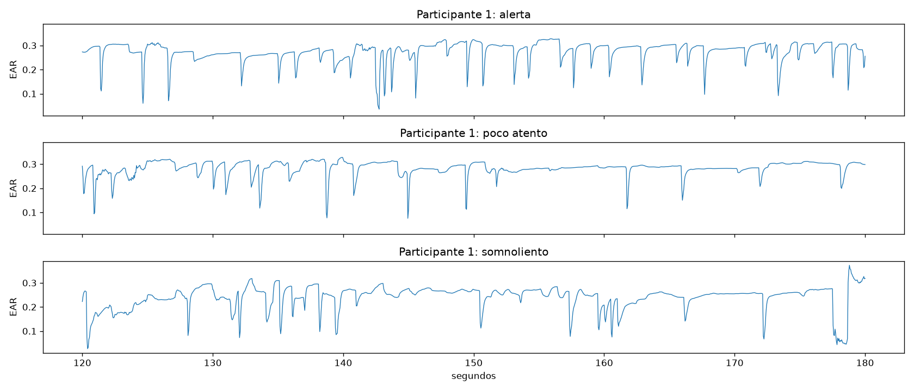
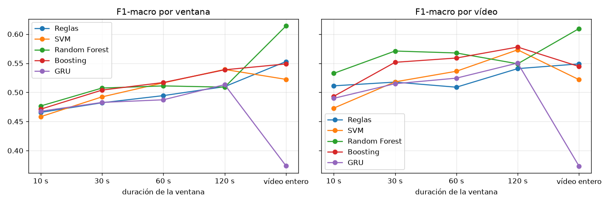
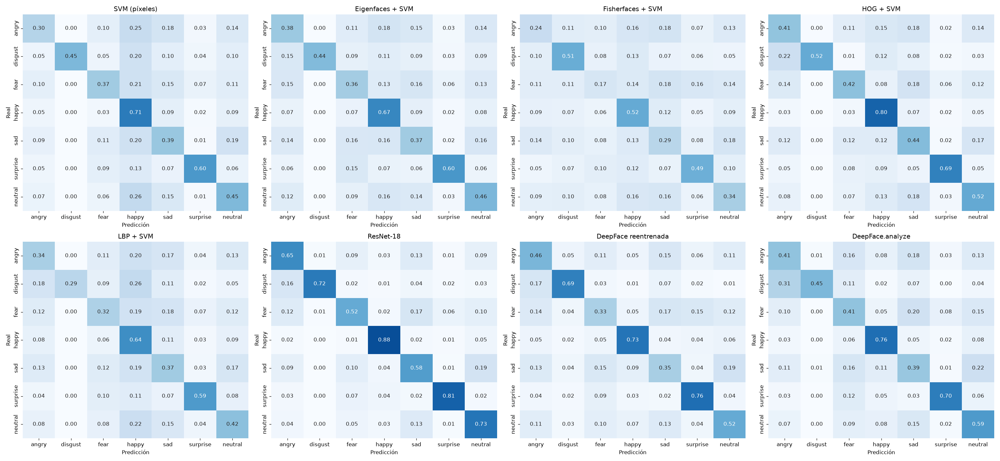

# Práctica 5 - Visión por Computador
## [Marcial Galván](https://github.com/Jose-Marcial-GF) - [Alejandra Rodríguez](https://github.com/alejandra-rs)

> [!NOTE]
> Esta práctica usa un _environment_ nuevo frente a prácticas anteriores. Los pasos a seguir para configurarlo se pueden consultar en [Instalación y uso](#instalación-y-uso).

Resolución de la quinta práctica de la asignatura Visión por Computador, en la que se busca aprender sobre:
- Detección de caras y de sus puntos de referencia (_landmarks_), comparando detectores clásicos y basados en redes neuronales.
- Entrenamiento de modelos para extraer características de una cara.
- Reacciones en tiempo real a la información extraída de las caras.

La resolución de ambas tareas a realizar se encuentra en [`prac5.ipynb`](prac5.ipynb). El resto de cuadernos analizan y escogen los modelos a utilizar.

### Tabla de contenidos
- [Tarea A: Estado de ánimo durante una lectura](#tarea-a-estado-de-ánimo-durante-una-lectura)
    - [Detección de somnolencia](#detección-de-somnolencia)
    - [Reconocimiento de emociones](#reconocimiento-de-emociones)
    - [Demostración](#demostración)
- [Tarea B: _Ceci n'est pas une pipe_](#tarea-b-ceci-nest-pas-une-pipe)
    - [Comparativa de detectores faciales](#comparativa-de-detectores-faciales)
    - [Prototipo de la pipa](#prototipo-de-la-pipa)
- [Instalación y uso](#instalación-y-uso)
    - [Instalación](#instalación)
    - [Datos y pesos](#datos-y-pesos)
    - [Uso](#uso)
    - [TensorBoard](#tensorboard)
- [Especificaciones del equipo](#especificaciones-del-equipo)
- [Fuentes consultadas](#fuentes-consultadas)

## Tarea A: Estado de ánimo durante una lectura

En esta tarea se implementa una herramienta que podrían utilizar, por ejemplo, un profesor o un ponente para saber en qué momentos pierden la atención de su público. En ella, se reproduce el capítulo 1 del **Quijote** mientras se analiza a quien lo escucha. Se estudian dos aspectos:

- **Somnolencia:** si la persona está alerta, poco atenta o somnolienta.
- **Emoción:** emoción predominante en su cara.

### Detección de somnolencia

#### Conjunto de datos

Se usa [UTA-RLDD](https://sites.google.com/view/utarldd/home) (_Real-Life Drowsiness Dataset_). En este _dataset_, 60 participantes graban y anotan vídeos de ellos mismos en distintos estados de atención. El propio conjunto viene dividido en 5 _folds_ por participante, que se usan para la validación cruzada.

En [`drowsiness_extraction.ipynb`](drowsiness_detection/drowsiness_extraction.ipynb) se preparan los datos:

1. **Reducción de los vídeos:** compresión, reducción de los FPS y de la resolución, para ocupar menos espacio.
2. **_Features_ por fotograma:** se extraen 12 características con el `FaceLandmarker` de MediaPipe para trabajar más cómodamente sobre los vídeos. Entre las _features_ extraídas, se encuentran el _Eye Aspect Ratio_ (EAR) de cada ojo y el _Mouth Aspect Ratio_ (MAR). Además de facilitar la manipulación de los datos, también ayuda a la compresión de la información, resumiéndose en unos 100 MB.

Por ejemplo, este es el análisis del EAR de un participante en sus 3 estados. Se observa la fluctuación de los valles (parpadeos) entre ellos:

<p align=center>

</p>

<p align=center><i>EAR de un mismo participante durante un minuto en cada estado. Cada caída es un parpadeo.</i></p>

#### Entrenamiento

Tras preprocesar los datos, estos se pueden utilizar para entrenar un modelo de detección de cansancio. En [`drowsiness_training.ipynb`](drowsiness_detection/drowsiness_training.ipynb) se analizan 5 modelos para este propósito:

- **Reglas:** umbrales sobre una sola _feature_. Concretamente, sobre las referentes a la apertura de los ojos, pues son las que proporcionan mejores resultados.
- **Métodos clásicos - SVM RBF, Random Forest y Gradient Boosting**, sobre las 12 _features_ de la ventana y con búsqueda de hiperparámetros (`GridSearchCV`).
- **GRU:** aproximación de _deep learning_, mediante una red recurrente.

Cada modelo se entrena en dos modos:

- **Sin calibrar:** umbrales uniformizados para todas las muestras. Puede no ser fiable, pues la forma de los ojos varía considerablemente.
- **Calibrado:** calibración de los umbrales con el primer minuto del vídeo _alerta_ de cada persona.

Cada vídeo se divide en ventanas de tamaño fijo sobre las que se calculan las 12 _features_. Se implementan estas ventanas para aportar robustez en la detección, pues un mayor tiempo de análisis proporciona mejores resultados, pero tarda más en responder.

La evaluación se realiza con 5-fold, utilizando los _folds_ del conjunto. Se calcula la F1-macro por ventana y por vídeo.

#### Resultados


<p align=center>

</p>

<p align=center><i>F1-macro (3 clases, calibrado) según la duración de la ventana.</i></p>

F1-macro (media ± desviación entre los 5 _folds_), con ventanas de 30 s:

| Modelo | 3 clases, sin calibrar | 3 clases, calibrado | Binaria, sin calibrar | Binaria, calibrado |
|---|---|---|---|---|
| Reglas | 0.487 ± 0.030 | 0.482 ± 0.049 | 0.689 ± 0.051 | 0.708 ± 0.074 |
| SVM | 0.483 ± 0.039 | 0.492 ± 0.048 | 0.698 ± 0.054 | 0.701 ± 0.050 |
| **Random Forest** | **0.468 ± 0.034** | **0.507 ± 0.041** | **0.687 ± 0.029** | **0.717 ± 0.049** |
| Boosting | 0.463 ± 0.024 | 0.504 ± 0.038 | 0.690 ± 0.030 | 0.710 ± 0.034 |
| GRU | 0.425 ± 0.020 | 0.483 ± 0.032 | 0.667 ± 0.044 | 0.750 ± 0.042 |

<p align=center><i>F1-macro por ventana. La tarea binaria solo distingue alerta y somnoliento.</i></p>

| Modelo | 3 clases, sin calibrar | 3 clases, calibrado | Binaria, sin calibrar | Binaria, calibrado |
|---|---|---|---|---|
| Reglas | 0.488 ± 0.027 | 0.518 ± 0.087 | 0.730 ± 0.059 | 0.737 ± 0.090 |
| SVM | 0.551 ± 0.045 | 0.518 ± 0.071 | 0.761 ± 0.060 | 0.724 ± 0.088 |
| **Random Forest** | **0.523 ± 0.062** | **0.571 ± 0.070** | **0.720 ± 0.022** | **0.781 ± 0.055** |
| Boosting | 0.468 ± 0.030 | 0.552 ± 0.079 | 0.727 ± 0.062 | 0.755 ± 0.068 |
| GRU | 0.437 ± 0.042 | 0.515 ± 0.031 | 0.663 ± 0.056 | 0.779 ± 0.039 |

<p align=center><i>F1-macro por vídeo.</i></p>


Se elige **Random Forest calibrado**, pues es el que mejores resultados proporciona. La tasa de acierto es bastante elevada y sus tiempos de ejecución son reducidos.

Nótese que la inclusión de una clase intermedia ("poca atención") puede dificultar la detección, al ser similar a los otros estados.

### Reconocimiento de emociones

#### Conjunto de datos

Se usa [FER2013](https://www.kaggle.com/datasets/deadskull7/fer2013) para la clasificación de las caras en 7 emociones, pues es el que se utilizó en `DeepFace.analyze`. Como complemento, también se utiliza [FER+](https://github.com/microsoft/FERPlus), que reetiqueta las mismas imágenes de forma más estable. En este _dataset_, las clases están muy desbalanceadas, lo que podría dificultar el entrenamiento.

Nuevamente, se realiza un _5-fold_, esta vez con las particiones _Training_ y _PublicTest_ del conjunto de datos. El subconjunto _PrivateTest_ se utiliza para generar las métricas.

#### Entrenamiento

En [`emotion_training.ipynb`](emotion_detection/emotion_training.ipynb) se comparan 8 modelos, evaluando su desempeño con ambas versiones de las anotaciones:

- **Clásicos:** SVM sobre píxeles, Eigenfaces (PCA), Fisherfaces (PCA + LDA), HOG y LBP, ajustando C y gamma.
- **ResNet-18:** _transfer learning_ partiendo de ImageNet. Se utilizan, además, _data augmentation_, pesos por clase, AdamW y _early stopping_.
- **DeepFace:** la red que usa `DeepFace.analyze`, en su versión original y en su versión reentrenada con un procedimiento similar al de _ResNet-18_.

#### Resultados

| Modelo | FER2013 _accuracy_ | FER2013 F1-macro | FER+ _accuracy_ | FER+ F1-macro |
|---|---|---|---|---|
| SVM (píxeles) | 0.490 ± 0.004 | 0.496 ± 0.008 | 0.593 ± 0.005 | 0.521 ± 0.008 |
| Eigenfaces + SVM | 0.485 ± 0.002 | 0.488 ± 0.005 | 0.601 ± 0.002 | 0.530 ± 0.004 |
| Fisherfaces + SVM | 0.358 ± 0.001 | 0.321 ± 0.001 | 0.400 ± 0.005 | 0.328 ± 0.005 |
| HOG + SVM | 0.565 ± 0.001 | 0.561 ± 0.004 | 0.690 ± 0.004 | 0.598 ± 0.010 |
| LBP + SVM | 0.458 ± 0.003 | 0.447 ± 0.006 | 0.568 ± 0.004 | 0.478 ± 0.002 |
| **ResNet-18** | **0.710 ± 0.003** | **0.703 ± 0.005** | **0.828 ± 0.003** | **0.748 ± 0.014** |
| DeepFace reentrenada | 0.539 ± 0.027 | 0.503 ± 0.028 | 0.715 ± 0.014 | 0.594 ± 0.018 |
| DeepFace.analyze | 0.558 | 0.543 | 0.548 | 0.472 |

<p align=center><i>Resultados de la inferencia sobre el PrivateTest.</i></p>

<p align=center>

</p>

<p align=center><i>Matrices de confusión con FER2013, normalizadas por fila.</i></p>

Además, se miden métricas adicionales como la robustez. Todas ellas se encuentran en el cuaderno correspondiente a estos análisis. 

Se elige **ResNet-18 entrenada con FER+**, pues, nuevamente, es la que mejores resultados proporciona. Además, es el más robusto (salvo en ruido y baja resolución, pero se podría solucionar colocando la _webcam_ en un lugar con buena iluminación) y tiene un coste asumible en _real-time_.

### Demostración

Con los modelos ya analizados y escogidos, se puede realizar la demostración combinando los distintos componentes. 

La lectura se encuentra pregrabada en [`assets/lectura.mp3`](assets/lectura.mp3) junto con un CSV en el que se registran sus frases ([`assets/lectura.csv`](assets/lectura.csv)), para poder seguir la lectura mientras se realiza la demostración ([`prac5.ipynb`](prac5.ipynb), sección 2). Mientras suena, se siguen las siguientes etapas:

- **Calibración** (primeros 40 s): para ajustar los cálculos del _Eye Aspect Ratio_, se mide la apertura de los ojos y la postura de la cabeza de la persona.
- **Somnolencia**: cada 10 s se mide el estado de cansancio. Se combinan distintos tamaños de ventana para realizar una demostración rápida y robusta.
- **Emociones**: se detecta la emoción de la persona 5 veces por segundo y se muestra la dominante en pantalla.

La implementación se encuentra en [`common/reading/`](common/reading):

- **Somnolencia** (`Drowsiness`, [`drowsiness.py`](common/reading/drowsiness.py)): guarda los rasgos de cada fotograma (EAR, MAR, postura...).
- **Emociones** (`Emotions`, [`emotions.py`](common/reading/emotions.py)): recorta la cara a 48 × 48 en escala de grises (como en FER2013) y la clasifica con la ResNet-18.
- **Texto** ([`overlay.py`](common/reading/overlay.py)): escribe texto (frase de la lectura y emoción actual) sobre la ventana.
- **Sesión** (`ReadingSession`, [`session.py`](common/reading/session.py)): carga la lectura y une las piezas anteriores.
- **Informe** (`plot_report`, [`report.py`](common/reading/report.py)): realiza un informe del estado de ánimo del participante durante toda la lectura, generando curvas de somnolencia y mostrando la emoción predominante cada 10 s.

## Tarea B: _Ceci n'est pas une pipe_

La inspiración para esta segunda tarea es la composición _La trahison des images_ (1929), en la que Magritte pinta la _representación_ de una pipa. En esta tarea ([`prac5.ipynb`](prac5.ipynb), sección 3), se realiza un filtro en el que se puede fumar la pipa de Magritte:

- La pipa flota en la imagen. Se puede coger pinzándola y moverla hacia donde se desee. Mientras se sujeta, la boquilla apunta a la boca.
- Al llevar la boquilla a la boca, se inhala y la cazoleta se enciende. Los pulmones se llenan paulatinamente.
- El humo sale siempre que se abre la boca. Al cerrarla, el humo restante se mantiene en los pulmones, hasta que se vuelve a abrir.

### Comparativa de detectores faciales

Puesto que en esta tarea se necesita un detector facial, en [`face_detectors.ipynb`](face_detectors.ipynb) se comparan 6 detectores: Viola-Jones, DNN ResNet-10, MTCNN, BlazeFace (MediaPipe), YuNet y RetinaFace. Es importante elegir un detector que sea robusto y que detecte la boca, dada la demostración en la que se va a incluir. Todos se evalúan en las mismas condiciones:

- **Datos:** 1,000 imágenes de la validación de [WIDER FACE](http://shuoyang1213.me/WIDERFACE/) (1,860 caras), escaladas a 640 píxeles de ancho. En cada imagen hay entre 1 y 10 caras, todas de al menos 40 píxeles de alto.
- **Umbral:** se dividen las imágenes en 2 subconjuntos. El primero se utiliza para la calibración de los umbrales. El segundo se usa para computar las métricas.
- **Métricas:** AP@50, _precision_, _recall_ y F1 (IoU ≥ 0.5).
- **Tiempo:** milisegundos por imagen sin contar la lectura.

#### Resultados

| Detector | AP@50 | F1 (umbral por defecto) | Umbral ajustado | Precision | Recall | F1 | ms por imagen | Boca |
|---|---|---|---|---|---|---|---|---|
| Viola-Jones | 0.546 | 0.586 | 9 vecinos | 0.837 | 0.483 | 0.613 | 8.4 | no |
| DNN ResNet-10 | 0.855 | 0.842 | 0.35 | 0.895 | 0.808 | 0.850 | 10.0 | no |
| MTCNN | 0.865 | 0.880 | 0.93 | 0.981 | 0.815 | 0.890 | 90.3 | sí |
| BlazeFace | 0.352 | 0.475 | 0.63 | 0.845 | 0.332 | 0.477 | 1.4 | sí |
| **YuNet** | **0.941** | **0.779** | **0.77** | **0.974** | **0.885** | **0.928** | **8.8** | **sí** |
| RetinaFace | 0.974 | 0.964 | 0.97 | 0.979 | 0.950 | 0.964 | 577.8 | sí |

<p align=center>

</p>

<p align=center><i>Curvas precision-recall de cada detector.</i></p>

Se elige **YuNet**, con su umbral ajustado en 0.77. Este detector es el que obtiene los mejores resultados cumpliendo los requisitos necesarios para su uso en la demostración. Se puede ejecutar en tiempo real (8.8ms) y devuelve la posición de la boca.

### Prototipo de la pipa

Para los detectores de manos y _landmarks_, se ha decidido utilizar los incluidos en MediaPipe (`HandLandmarker` y `FaceLandmarker`), por su buen _trade-off_ entre resultados y tiempo de ejecución (incluso en CPU).

La pipa es una imagen PNG con transparencia, recortada sobre el cuadro original ([`assets/pipe.png`](assets/pipe.png)). Sobre esta imagen, también se han determinado puntos característicos (boquilla, cazoleta), en [`assets/pipe.json`](assets/pipe.json). Si se quisiera utilizar otra imagen, basta con cambiar estos dos ficheros.

La implementación de las distintas partes del filtro se encuentra en [`common/pipe/`](common/pipe):

- **Pipa** (`Pipe`, [`pipe.py`](common/pipe/pipe.py)): se coloca sobre la escena con transformaciones. Su largo se ajusta al tamaño de la cara, se gira para apuntar la boquilla a la boca al cogerla y se endereza al soltarla. También dibuja la brasa (elipse naranja en la cazoleta).
- **Mano** (`Hands`, [`landmarks.py`](common/pipe/landmarks.py), y `PinchGrab`, [`scene.py`](common/pipe/scene.py)): MediaPipe devuelve 21 _landmarks_ por mano. Se detecta el agarre utilizando la distancia entre las puntas del pulgar y del índice, dividida entre el tamaño de la mano.
- **Boca** (`MouthOpening`, [`landmarks.py`](common/pipe/landmarks.py)): se utiliza el `FaceLandmarker` de MediaPipe sobre el recorte de la cara realizado por YuNet, para conocer la apertura de la boca.
- **Humo** (`Smoke`, [`smoke.py`](common/pipe/smoke.py)): sistema de partículas. Se crean en la cazoleta o en la boca. Se dibujan como manchas gaussianas que crecen y se aclaran con la edad. Como es habitual en este tipo de sistemas, la opacidad es $1 - e^{-\text{densidad}}$, lo que causa el espesor del humo donde se acumula.
- **Escena** (`PipeScene`, [`scene.py`](common/pipe/scene.py), y `Smoking`, [`smoking.py`](common/pipe/smoking.py)): une las distintas piezas para generar el _pipeline_ ya mencionado.

## Instalación y uso

### Instalación

Todos los experimentos se han realizado con Python 3.11 y en Windows 11. Las demostraciones se pueden realizar en CPU. Sin embargo, los entrenamientos, al utilizar PyTorch, necesitan una GPU NVIDIA. Los pasos para configurar el entorno son:

1. Crear un entorno virtual con Python 3.11 y activarlo.
2. Si se quiere entrenar algún modelo, instalar PyTorch con CUDA (en el caso de una RTX serie 50 necesita CUDA 12.8 o superior). Si no se requiere, solo se necesita instalar la versión para CPU en el paso 3.
   ```
   pip install torch torchvision --index-url https://download.pytorch.org/whl/cu128
   ```
3. Instalar las dependencias ([`requirements.txt`](requirements.txt)):
   ```
   pip install -r requirements.txt
   ```
4. Dejar un solo OpenCV. MediaPipe instala `opencv-contrib-python`, y retina-face y DeepFace la versión _headless_ (sin ventanas). Mantener una única versión, pues de no ser así se generan fallos en `cv2`:
   ```
   pip uninstall opencv-python opencv-contrib-python opencv-contrib-python-headless
   pip install opencv-contrib-python==4.12.0.88
   ```

### Datos y pesos

Se descargan automáticamente la primera vez que se necesitan:

- **Pesos de los detectores** (`weights/`): DNN, YuNet, BlazeFace y los detectores de manos y de puntos faciales de MediaPipe. RetinaFace y DeepFace se descargan en `~/.deepface/weights`.
- **WIDER FACE** (`data/wider_face/`): carpetas comprimidas de anotaciones e imágenes de validación (360 MB). En el código se leen los archivos directamente desde las carpetas comprimidas.
- **Etiquetas de FER+** (`data/fer2013/fer2013new.csv`).

Hay que descargar a mano:

- **UTA-RLDD**: las 10 carpetas comprimidas de [Google Drive](https://drive.google.com/drive/folders/1d_QwgpMXnLY_FmLYXDn7TLcw0D-svXEl), descomprimidas en la carpeta indicada en `videos_dir` de [`drowsiness.yaml`](drowsiness_detection/drowsiness.yaml#L2) (`data/uta_rldd/original/`).
- **FER2013**: [`fer2013.csv`](https://www.kaggle.com/datasets/deadskull7/fer2013), en `data/fer2013/`.

El resto de datos, como los modelos entrenados, se generan al ejecutar los _notebooks_ de entrenamiento.

### Uso

Los cuadernos se pueden ejecutar en este orden, y cada uno reutiliza los resultados que ya haya guardado:

1. [`drowsiness_detection/drowsiness_extraction.ipynb`](drowsiness_detection/drowsiness_extraction.ipynb): reduce los vídeos de UTA-RLDD y extrae las _features_ de cada fotograma.
2. [`drowsiness_detection/drowsiness_training.ipynb`](drowsiness_detection/drowsiness_training.ipynb): entrena y compara los modelos de detección de somnolencia.
3. [`emotion_detection/emotion_training.ipynb`](emotion_detection/emotion_training.ipynb): entrena y compara los modelos de detección de emociones.
4. [`face_detectors.ipynb`](face_detectors.ipynb): compara los detectores faciales.
5. [`prac5.ipynb`](prac5.ipynb): las 2 demostraciones. Únicamente se ejecutan si `RUN_READING = True` o `RUN_PIPE = True`.

### TensorBoard

Los entrenamientos de las redes neuronales (GRU, ResNet-18 y DeepFace) vuelcan sus datos de entrenamiento en `runs/`. Se pueden consultar ejecutando desde la carpeta `prac5/`:

```
tensorboard --logdir runs
```

y abriendo <http://localhost:6006>.

## Especificaciones del equipo

Todas las métricas se han obtenido sobre el mismo dispositivo:

| Componente | Detalle |
|---|---|
| Sistema operativo | Windows 11 |
| CPU | AMD, 8 núcleos físicos |
| RAM | 34 GB |
| GPU (entrenamientos) | NVIDIA GeForce RTX 5080 (16 GB) |
| Python | 3.11.18 |
| Librerías | opencv-contrib-python 4.12.0.88, mediapipe 1.2.3, mtcnn 1.0.0, tensorflow 2.21.0, retina-face 0.0.19 |

## Fuentes consultadas

### Tarea A

- [UTA-RLDD: Real-Life Drowsiness Dataset](https://sites.google.com/view/utarldd/home)
- [A Realistic Dataset and Baseline Temporal Model for Early Drowsiness Detection (UTA-RLDD) - arXiv](https://arxiv.org/abs/1904.07312)
- [Real-Time Eye Blink Detection using Facial Landmarks (EAR) - Soukupová y Čech, CVWW 2016](https://vision.fe.uni-lj.si/cvww2016/proceedings/papers/05.pdf)
- [Face landmarker - MediaPipe](https://ai.google.dev/edge/mediapipe/solutions/vision/face_landmarker)
- [Learning Phrase Representations using RNN Encoder-Decoder (GRU) - arXiv](https://arxiv.org/abs/1406.1078)
- [Ensembles: Random Forest y Gradient Boosting - scikit-learn](https://scikit-learn.org/stable/modules/ensemble.html)
- [Permutation feature importance - scikit-learn](https://scikit-learn.org/stable/modules/permutation_importance.html)
- [FFmpeg](https://ffmpeg.org) e [imageio-ffmpeg - GitHub](https://github.com/imageio/imageio-ffmpeg)
- [FER2013 - Kaggle](https://www.kaggle.com/datasets/deadskull7/fer2013)
- [Challenges in Representation Learning: A report on three machine learning contests (FER2013) - arXiv](https://arxiv.org/abs/1307.0414)
- [FER+ - GitHub](https://github.com/microsoft/FERPlus)
- [Training Deep Networks for Facial Expression Recognition with Crowd-Sourced Label Distribution (FER+) - arXiv](https://arxiv.org/abs/1608.01041)
- [Deep Residual Learning for Image Recognition (ResNet) - arXiv](https://arxiv.org/abs/1512.03385)
- [`resnet18` - torchvision](https://pytorch.org/vision/stable/models/generated/torchvision.models.resnet18.html)
- [DeepFace - GitHub](https://github.com/serengil/deepface) y [su modelo de emociones - Hugging Face](https://huggingface.co/nxp/deepface-emotion-imx)
- [Histograms of Oriented Gradients for Human Detection (HOG) - Dalal y Triggs, CVPR 2005](https://lear.inrialpes.fr/people/triggs/pubs/Dalal-cvpr05.pdf)
- [`hog` y `local_binary_pattern` - scikit-image](https://scikit-image.org/docs/stable/api/skimage.feature.html)
- [PCA](https://scikit-learn.org/stable/modules/generated/sklearn.decomposition.PCA.html) y [LDA](https://scikit-learn.org/stable/modules/generated/sklearn.discriminant_analysis.LinearDiscriminantAnalysis.html) - scikit-learn
- [Don Quijote de la Mancha, capítulo I - Proyecto Gutenberg](https://www.gutenberg.org/ebooks/2000)
- [Kokoro-82M (síntesis de voz con la que se generó el audio) - Hugging Face](https://huggingface.co/hexgrad/Kokoro-82M)
- [python-sounddevice](https://python-sounddevice.readthedocs.io)

### Tarea B

- [WIDER FACE: A Face Detection Benchmark](http://shuoyang1213.me/WIDERFACE/) y [su copia en Hugging Face](https://huggingface.co/datasets/CUHK-CSE/wider_face)
- [Rapid Object Detection using a Boosted Cascade of Simple Features (Viola-Jones)](https://www.cs.cmu.edu/~efros/courses/LBMV07/Papers/viola-cvpr-01.pdf)
- [Joint Face Detection and Alignment using Multi-task Cascaded Convolutional Networks (MTCNN) - arXiv](https://arxiv.org/abs/1604.02878)
- [BlazeFace: Sub-millisecond Neural Face Detection on Mobile GPUs - arXiv](https://arxiv.org/abs/1907.05047)
- [YuNet - OpenCV Zoo](https://github.com/opencv/opencv_zoo/tree/main/models/face_detection_yunet)
- [RetinaFace: Single-stage Dense Face Localisation in the Wild - arXiv](https://arxiv.org/abs/1905.00641)
- [retina-face - GitHub](https://github.com/serengil/retinaface)
- [Face detector - MediaPipe](https://ai.google.dev/edge/mediapipe/solutions/vision/face_detector)
- [Hand landmarker - MediaPipe](https://ai.google.dev/edge/mediapipe/solutions/vision/hand_landmarker)
- [Face landmarker - MediaPipe](https://ai.google.dev/edge/mediapipe/solutions/vision/face_landmarker)
- [_La trahison des images_ - René Magritte (LACMA)](https://collections.lacma.org/node/239578)
- [Geometric Image Transformations (`cv2.warpAffine`) - OpenCV](https://docs.opencv.org/4.x/da/d54/group__imgproc__transform.html)

### Inteligencia artificial

