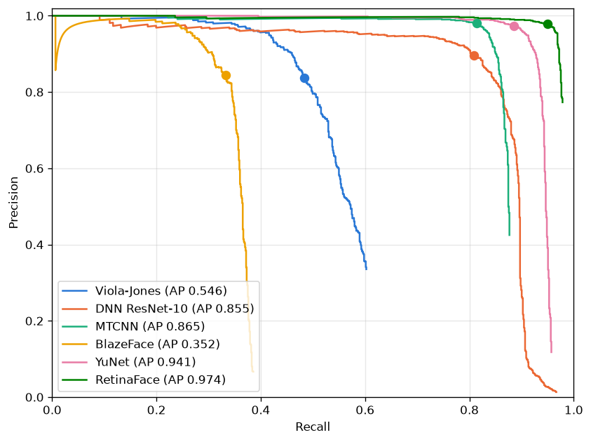

# Práctica 5 - Visión por Computador
## [Marcial Galván](https://github.com/Jose-Marcial-GF) - [Alejandra Rodríguez](https://github.com/alejandra-rs)

> [!NOTE]
> Esta práctica usa un _environment_ nuevo (MediaPipe, TensorFlow, MTCNN, RetinaFace...). Los pasos están en [Instalación y uso](#instalación-y-uso).

Resolución de la quinta práctica de la asignatura Visión por Computador, en la que se busca aprender sobre:
- Detección de caras y de sus puntos de referencia (_landmarks_), comparando detectores clásicos y basados en redes neuronales.
- Entrenamiento de un modelo propio para extraer información biométrica de una cara.
- Prototipos que reaccionan en tiempo real a la información extraída de las caras.

El programa final es [`prac5.ipynb`](prac5.ipynb), con los prototipos. El detector facial que utilizan se elige en [`face_detectors_comparative.ipynb`](face_detectors_comparative.ipynb).

### Tabla de contenidos
- [Comparativa de detectores faciales](#comparativa-de-detectores-faciales)
- [Prototipo A](#prototipo-a)
- [Prototipo B: _Ceci n'est pas une pipe_](#prototipo-b-ceci-nest-pas-une-pipe)
- [Extra: parecido con famosos](#extra-parecido-con-famosos)
- [Instalación y uso](#instalación-y-uso)
- [Especificaciones del equipo](#especificaciones-del-equipo)
- [Fuentes consultadas](#fuentes-consultadas)

## Comparativa de detectores faciales

En [`face_detectors_comparative.ipynb`](face_detectors_comparative.ipynb) se comparan seis detectores: los tres del cuaderno de la asignatura (Viola-Jones, la DNN ResNet-10 y MTCNN), BlazeFace (MediaPipe), YuNet (incluido en OpenCV) y RetinaFace. Todos se evalúan en las mismas condiciones:

- **Datos:** 1,000 imágenes de la validación de [WIDER FACE](http://shuoyang1213.me/WIDERFACE/), escaladas a 640 píxeles de ancho (la resolución de una webcam), con entre 1 y 10 caras, todas de al menos 40 píxeles de alto.
- **Umbral:** para cada detector se busca el umbral con el mayor F1 en la mitad de las imágenes, y las métricas se calculan con la otra mitad.
- **Métricas:** AP@50, _precision_, _recall_ y F1.
- **Tiempo:** milisegundos por imagen en CPU.

| Detector | AP@50 | F1 (umbral por defecto) | Umbral ajustado | Precision | Recall | F1 | ms por imagen | Boca |
|---|---|---|---|---|---|---|---|---|
| Viola-Jones | 0.546 | 0.586 | 9 vecinos | 0.837 | 0.483 | 0.613 | 8.4 | no |
| DNN ResNet-10 | 0.855 | 0.842 | 0.35 | 0.895 | 0.808 | 0.850 | 10.0 | no |
| MTCNN | 0.865 | 0.880 | 0.93 | 0.981 | 0.815 | 0.890 | 90.3 | sí |
| BlazeFace | 0.352 | 0.475 | 0.63 | 0.845 | 0.332 | 0.477 | 1.4 | sí |
| **YuNet** | **0.941** | **0.779** | **0.77** | **0.974** | **0.885** | **0.928** | **8.8** | **sí** |
| RetinaFace | 0.974 | 0.964 | 0.97 | 0.979 | 0.950 | 0.964 | 350.1 | sí |

<p align=center>

</p>

Se elige **YuNet**, con el umbral ajustado (0.77), el único que cumple los dos requisitos del prototipo con buena precisión:

- **Tiempo real:** el prototipo también detecta las manos y dibuja la escena en cada fotograma, por lo que el detector facial puede usar como mucho 20 ms. YuNet tarda 8.8 ms, unas 40 veces menos que RetinaFace y 10 veces menos que MTCNN.
- **Posición de la boca:** devuelve las comisuras. Viola-Jones y la DNN solo devuelven la caja.

Además:

- **El umbral por defecto importa tanto como el modelo:** con 0.9, YuNet pierde el 35 % de las caras (F1 de 0.779); con 0.77, el F1 sube a 0.928.
- **BlazeFace** es el más rápido, pero es de corto alcance (entrada de 128 × 128, pensado para selfies) y falla con caras pequeñas.

Resultados guardados en [`results/face_detectors/`](results/face_detectors):

- `summary.csv`: la tabla anterior.
- `system_info.json`: el equipo y las versiones de las librerías con las que se han medido los tiempos.
- `pr_curves.png`: las curvas _precision-recall_.
- `dets/` (fuera del repositorio): las detecciones de cada detector, para no tener que repetirlas.

## Prototipo A

_Pendiente._

## Prototipo B: _Ceci n'est pas une pipe_

En _La trahison des images_ (1929), Magritte pinta una pipa y escribe debajo «Ceci n'est pas une pipe»: es la imagen de una pipa, no una pipa. Este prototipo ([`prac5.ipynb`](prac5.ipynb), sección 3) lleva la idea a la webcam, con una pipa que tampoco es una pipa, pero que se puede coger y fumar:

1. La pipa flota en la imagen, con la leyenda del cuadro debajo.
2. Se coge con una **pinza** del pulgar y el índice, y sigue a la mano. Al abrir la pinza, se queda donde se ha soltado.
3. Mientras se sujeta, la boquilla apunta a la **boca**.
4. Al llevar la boquilla a la boca, la cazoleta **se enciende** y los pulmones se llenan en 4 segundos.
5. El humo sale siempre que se **abre la boca**, esté la pipa donde esté: un chorro de humo y, cada 0.4 segundos, una **burbuja de humo**. Al cerrar la boca, el humo que queda se aguanta en los pulmones hasta que se vuelva a abrir. Mientras se exhala, la leyenda cambia a «Ceci n'est pas de la fumée».

Se usan tres modelos:

| Modelo | Para qué |
|---|---|
| YuNet (elegido en la comparativa) | Posición de la boca y tamaño de la cara |
| Detector de manos de MediaPipe (21 puntos) | La pinza |
| Detector de puntos faciales de MediaPipe (478 puntos), sobre el recorte de YuNet | Si la boca está abierta (distancia entre labios / ancho de la boca > 0.1) |

La pipa es una imagen PNG ([`assets/pipe.png`](assets/pipe.png)). Para usar otra, basta con cambiar el PNG y sus tres puntos de referencia (agarre, boquilla y cazoleta) en el cuaderno.

## Extra: parecido con famosos

_Pendiente._

## Instalación y uso

### Instalación

Se ha probado con Python 3.11 en Windows 11, en CPU.

1. Crear un entorno virtual con Python 3.11 y activarlo.
2. Instalar las dependencias ([`requirements.txt`](requirements.txt)):
   ```
   pip install -r requirements.txt
   ```
3. Dejar un solo OpenCV. MediaPipe instala `opencv-contrib-python` y retina-face la versión _headless_ (sin ventanas); con varios a la vez, `cv2` falla o no puede abrir la webcam:
   ```
   pip uninstall opencv-python opencv-contrib-python opencv-contrib-python-headless
   pip install opencv-contrib-python==4.12.0.88
   ```
4. Registrar el entorno como _kernel_ de Jupyter y elegirlo en los cuadernos. OpenCV 5 eliminó `CascadeClassifier` (Viola-Jones), por lo que no sirve otro Python con OpenCV 5:
   ```
   python -m ipykernel install --user --name VC_P5 --display-name "Python (VC_P5)"
   ```

RetinaFace se ejecuta con su modelo ONNX: el de TensorFlow no se puede construir con Keras 3.

### Datos y pesos

Todo se descarga automáticamente la primera vez que se necesita:

- **Pesos de los modelos** (`weights/`): la DNN de la asignatura, YuNet, BlazeFace y los detectores de manos y de puntos faciales de MediaPipe. RetinaFace se descarga en `~/.deepface/weights`.
- **WIDER FACE** (`data/wider_face/`): los zips de anotaciones e imágenes de validación (360 MB). Se leen directamente de los zips, ya que al descomprimirlos dentro de OneDrive algunas rutas superan el límite de 260 caracteres de Windows.

### Uso

1. [`face_detectors_comparative.ipynb`](face_detectors_comparative.ipynb): compara los detectores y justifica la elección (YuNet, que usa `prac5.ipynb`).
2. [`prac5.ipynb`](prac5.ipynb): los prototipos. Para abrir la webcam, cambiar `RUN_PIPE = True` en la sección 3.7.

| Tecla | Acción |
|---|---|
| Pinza sobre la pipa | Cogerla (abrir la pinza la suelta) |
| **r** | Devolver la pipa a su sitio |
| **v** | Empezar o parar la grabación (`results/pipe/*.mp4`) |
| **ESC** | Salir |

## Especificaciones del equipo

| Componente | Detalle |
|---|---|
| Sistema operativo | Windows 11 |
| CPU | AMD, 8 núcleos físicos |
| RAM | 34 GB |
| Python | 3.11.18 |
| Librerías | opencv-contrib-python 4.12.0.88, mediapipe 1.2.3, mtcnn 1.0.0, tensorflow 2.21.0, retina-face 0.0.19, onnxruntime 1.32.0 |

## Fuentes consultadas

### Comparativa de detectores faciales

- [WIDER FACE: A Face Detection Benchmark](http://shuoyang1213.me/WIDERFACE/) y [su copia en Hugging Face](https://huggingface.co/datasets/CUHK-CSE/wider_face)
- [Cuaderno de detectores de la asignatura (P5)](https://github.com/otsedom/otsedom.github.io/tree/main/VC/P5)
- [Rapid Object Detection using a Boosted Cascade of Simple Features (Viola-Jones)](https://www.cs.cmu.edu/~efros/courses/LBMV07/Papers/viola-cvpr-01.pdf)
- [Joint Face Detection and Alignment using Multi-task Cascaded Convolutional Networks (MTCNN) - arXiv](https://arxiv.org/abs/1604.02878)
- [BlazeFace: Sub-millisecond Neural Face Detection on Mobile GPUs - arXiv](https://arxiv.org/abs/1907.05047)
- [YuNet - OpenCV Zoo](https://github.com/opencv/opencv_zoo/tree/main/models/face_detection_yunet)
- [RetinaFace: Single-stage Dense Face Localisation in the Wild - arXiv](https://arxiv.org/abs/1905.00641)
- [retina-face - GitHub](https://github.com/serengil/retinaface)
- [Face detector - MediaPipe](https://ai.google.dev/edge/mediapipe/solutions/vision/face_detector)

https://link.springer.com/article/10.1007/s11633-023-1423-y

### Prototipo B

- [Hand landmarker - MediaPipe](https://ai.google.dev/edge/mediapipe/solutions/vision/hand_landmarker)
- [Face landmarker - MediaPipe](https://ai.google.dev/edge/mediapipe/solutions/vision/face_landmarker)
- [_La trahison des images_ - René Magritte (LACMA)](https://collections.lacma.org/node/239578)
- [Geometric Image Transformations (`cv2.warpAffine`) - OpenCV](https://docs.opencv.org/4.x/da/d54/group__imgproc__transform.html)

_Uso de inteligencia artificial: se ha usado Claude para preparar la comparativa de detectores y el prototipo de la pipa._
